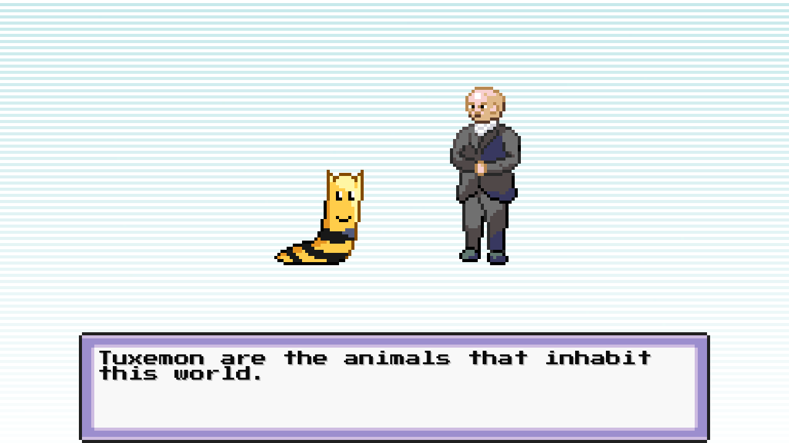
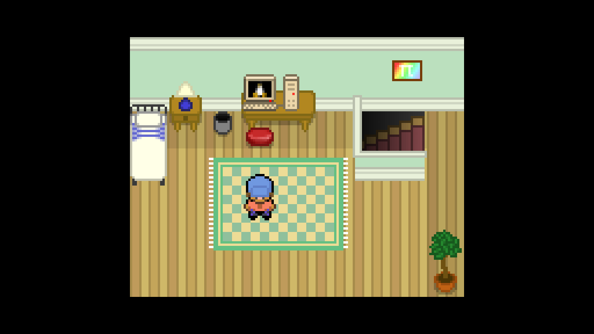

# נגמון: תוכנית משחק לימודי למשפחה

> מסמך תכנון, שלב 0. הוא נכתב אחרי לימוד הקוד של Tuxemon (הבסיס של הריפו).
> המטרה היא משחק שהילדים ירצו לשחק בו גם בלי הלמידה, ושבו הלמידה היא מה שנותן להם כוח.
> מונחים טכניים נשארים באנגלית. הפניות לקוד הן בצורה `file:line`.

---

## 0. עדכונים אחרי ההחלטות שלך והמחקר

**ההחלטות שלך:**
- ילדים בגילאי 5–12. התוכן מגיע עד כיתה ט'. (פרטי המשפחה בריפו הפרטי `nagmon-data`, `family/FAMILY.md`.)
- **מחשב** (Windows ו־Linux) במקום טלפון.
- **צניעות.**
- מודל מרוחק, כל ספק חינמי.
- פרסים אמיתיים.

**שינויים בעקבות המחקר** (`RESEARCH_LEARNING.md`, `RESEARCH_AI_PROVIDERS.md`). הם גוברים על מה שכתוב בהמשך המסמך:

| נושא | קודם | עכשיו | למה |
|---|---|---|---|
| פרסים אמיתיים | "100 כוכבים = גלידה" | **חגיגות הפתעה** שההורה מגדיר. המערכת מציעה להורה מתי מגיעה חגיגה (על מאמץ: ימי תרגול, מיומנות שנשלטה). אין "מחירון" גלוי לילדים. אפשר להדליק "יעדים גלויים", עם הסבר | פרס מוחשי שמובטח מראש פוגע במוטיבציה הפנימית של ילדים (Deci, Koestner & Ryan 1999) |
| טיימר ומהירות | "נכון ומהר = ×2" | **בלי טיימר ובלי ניקוד מהירות מתחת לגיל 9.** מעל 9: בונוס אופציונלי בלבד, בלי עונש על איטיות | טיימר מעלה חרדה, ואין תועלת לצעירים |
| יעד הצלחה | 75–80% | **כ־80%** במיומנות חדשה, **כ־90%** בחזרה, **85–90%** לגילאי 5–7 | ילדים עם יעד הצלחה גבוה יותר תרגלו יותר והשתפרו יותר |
| "לא יודע" | — | **כפתור רמז / "לא יודע"** בכל שאלה | מוריד ניחושים ותסכול |
| משוב | הסבר של שורה | **תמיד:** נכון או לא, התשובה הנכונה, וצעד פתרון. **דוגמה פתורה** מהינשוף לפני מיומנות חדשה | משוב מוסבר עדיף בהרבה על "נכון/לא נכון" |
| רצף יומי | רצף ימים | **יעד שבועי עם מרווח** ("3 ימים השבוע"). אין "רצף שנשבר", ושבת וחג לא נספרים | רצף שנשבר מוריד מוטיבציה |
| מטרה משפחתית | סכום כוכבים | **כל ילד עומד ביעד האישי שלו**, ואז המשפחה מנצחת | סכום מעדיף את הגדול |
| קרב | שאלה מאותה מיומנות | **ערבוב (interleaving)** של מיומנויות שהילד כבר פגש. בוס = מבחן מעורב | ערבוב שיפר מבחן מאוחר מ־38% ל־61% |
| שילוב הלמידה | כרטיס שאלה לפני התקפה | בנוסף: **בכל אזור לפחות מנגנון אחד שבו התוכן הוא הפעולה עצמה**, למשל מפלצת שמתחלקת רק במכה הנכונה | למידה שהיא חלק מהמנגנון עובדת טוב יותר |
| אנגלית | סולם שפה | **הוראה מפורשת של מילה ← חזרה ← הופעה בהקשר.** גילאי 5–7: שמיעה ותמונה בלבד | חשיפה אגבית לבד מלמדת מעט |
| עצירה | "הזמן נגמר" | **התראה 5 דקות לפני**, וסיום בנקודת עצירה טבעית | |
| AI לילדים | Gemini או מקומי | **Groq** (בלי אימון על הנתונים, עם Zero Data Retention). Gemini רק לסטודיו של ההורה. מבוגר הוא המשתמש | תנאי שימוש ופרטיות |
| צניעות | — | **בוצע.** 114 דיוקנאות הוחלפו בתחליף צנוע, ולגיבורה צוירה חצאית ארוכה (`SDD_MODESTY.md`) | |

---

## תוכן

1. [השורה התחתונה](#1-השורה-התחתונה)
2. [מה יש לנו ביד: לימוד הקוד](#2-מה-יש-לנו-ביד-לימוד-הקוד)
3. [עקרונות עיצוב](#3-עקרונות-עיצוב)
4. [העולם והסיפור](#4-העולם-והסיפור)
5. [לולאות המשחק: איך לימוד הופך לכוח](#5-לולאות-המשחק-איך-לימוד-הופך-לכוח)
6. [מנוע הלמידה](#6-מנוע-הלמידה)
7. [תוכן לימודי לפי מקצוע](#7-תוכן-לימודי-לפי-מקצוע)
8. [שפה: עברית מלאה ואנגלית שגדלה עם הילד](#8-שפה-עברית-מלאה-ואנגלית-שגדלה-עם-הילד)
9. [פרופיל לכל ילד באותו טלפון](#9-פרופיל-לכל-ילד-באותו-טלפון)
10. [אזור ההורים ואורחות החיים של המשפחה](#10-אזור-ההורים-ואורחות-החיים-של-המשפחה)
11. [AI: מפתח חינמי ומודל מקומי](#11-ai-מפתח-חינמי-ומודל-מקומי)
12. [ארכיטקטורה טכנית](#12-ארכיטקטורה-טכנית)
13. [פלטפורמה: טלפון אנדרואיד](#13-פלטפורמה-טלפון-אנדרואיד)
14. [שלבי עבודה](#14-שלבי-עבודה)
15. [סיכונים והחלטות פתוחות](#15-סיכונים-והחלטות-פתוחות)
16. [נספח: מקורות](#16-נספח-מקורות)

---

## 1. השורה התחתונה

- **הבסיס מתאים מאוד.** Tuxemon הוא משחק אספנות מפלצות בסגנון פוקימון:
  - 411 מפלצות, 274 התקפות, 230 פריטים ו־263 מפות;
  - מערכת סקריפטים למפות, משימות, חנויות, טלפון בתוך המשחק ושמירות;
  - כמעט כל הטקסט עובר דרך קובץ תרגום אחד.
- **יש בקוד כבר את רוב הווים שנדרשים**:
  - חידון רב־ברירה (`MinigameState`);
  - בורר רמת קושי;
  - מכפיל נזק שמחכה למי שיעביר לו ערך (`additional_factors` ב־`formula.py`);
  - התפתחות מפלצות לפי משתני משחק;
  - משימות שמתקדמות לפי משתנים;
  - "שפה סודית" (`cipher_processor`) שאפשר להפוך ללימוד אותיות.
- **מה חסר:**
  - **עברית:** אין פונט עם אותיות עבריות, אין תמיכה בכיוון ימין־לשמאל (bidi), ו־5,373 מחרוזות לתרגם.
  - **מנוע למידה:** מחוללי שאלות, מודל שליטה לכל ילד, חזרה מרווחת.
  - **פרופילים לכל ילד.**
  - **אזור הורים.**
  - **שילוב השאלות** בקרב, בלכידה, בחנויות ובעולם.
- **ההחלטה המרכזית בעיצוב:** לא "חידון שקוטע את המשחק". **הלמידה היא מנגנון הכוח של המשחק:**
  - תשובה נכונה = מכה קריטית, לכידה מוצלחת והנחה בחנות;
  - שליטה במקצוע = כוכבי ידע שפותחים אזורים ומאפשרים למפלצות להתפתח.
  - טעות לא מענישה: ההתקפה יוצאת רגילה, ומוצג הסבר קצר.
- **ממצא חשוב על AI:** תנאי השימוש של Gemini API **אוסרים** להשתמש בו באפליקציה שמיועדת לקטינים או שקטינים צפויים להשתמש בה. לכן:
  - **כל התוכן הלימודי עובד בלי אינטרנט ובלי AI**: מחוללים פרוצדורליים ומאגרי שאלות.
  - **AI בענן** משמש רק את ההורה, ב"סטודיו תוכן" (יצירת שאלות, סיפורים ומשימות שההורה מאשר).
  - **AI בזמן משחק** רץ רק על מודל מקומי (Ollama על המחשב בבית, ובהמשך אולי על הטלפון).
- **הריפו עוד ציבורי, ואני לא יכול לשנות את זה מכאן.** הוא fork ציבורי של Tuxemon, ו־GitHub לא מאפשר להפוך fork לפרטי כל עוד הוא מחובר לרשת ה־fork. ההוראות בסעיף 15.

---

## 2. מה יש לנו ביד: לימוד הקוד

### 2.1 מבנה

| חלק | איפה | מה חשוב לנו |
|---|---|---|
| מנוע | `tuxemon/` (כ־102 אלף שורות Python, pygame-ce) | מכונת מצבים (states), מנוע אירועים, קרב, שמירה |
| תוכן | `mods/tuxemon/` (196MB, מתוכם 147MB מוזיקה) | `db/*.yaml`, מפות Tiled (`.tmx`) עם סקריפטים, תרגומים, גרפיקה |
| הגדרות | `mods/*.yaml` | איזון קרב ולכידה, מסיבות מאמנים, טלפון, רדיו, מיילים |
| בדיקות | `tests/` (כ־47 אלף שורות) | pytest |

### 2.2 נקודות חיבור שכבר קיימות (והן הבסיס לתוכנית)

| צורך | נקודת החיבור בקוד |
|---|---|
| מסך שאלה | `tuxemon/states/minigame.py:25`: חידון "מי המפלצת" עם ניקוד ורצף. נעתיק אותו ל־`QuizState` |
| מצב חדש בלי לגעת במנוע | `mods/<mod>/states/*.py` נטען אוטומטית ודורס מצב בעל אותו שם (`tuxemon/state/loader.py:53`) |
| שאלה לפני התקפה | `tuxemon/states/combat_menus.py:620`: `enqueue_technique` לפני `enqueue_action` |
| בונוס נזק | `tuxemon/formula.py:61`: `additional_factors` כבר מוכפל בנזק, ואף אחד לא מעביר אותו היום |
| מכה בטוחה | `combat_session.set_tech_hit(user, 0.0)`, יש תקדים ב־`core/effects/charmed.py:63` |
| בונוס לכידה | `tuxemon/core/effects/capture.py:41` ו־`formula.py:538` (`specific_variables_modifiers`) |
| אפקט חדש | `mods/<mod>/effects/*.py` דורס אפקט ליבה לפי `name` (`core/core_manager.py:87`) |
| פעולות ותנאים בסקריפט מפה | `mods/<mod>/event/actions` ו־`event/conditions` (רק הוספה. אי אפשר לדרוס פעולת ליבה) |
| שמירת התקדמות | `NPCState.game_variables` נשמר ב־JSON (`save_system/save_state.py:47`) |
| התפתחות לפי למידה | `MonsterEvolutionItemModel` תומך בתנאי משתני משחק (`db.py:978`) |
| משימות | `db/mission/*.yaml`: שלבים שמתקדמים לפי משתנים |
| אתגר יומי | NuPhone, מיילים, שיחות טלפון ורדיו מותנים במשתנים (`mods/phone_calls.yaml`, `email.yaml`, `radio_data.yaml`) |
| רמת קושי | `tuxemon/states/difficulty_pick.py` |
| לימוד אותיות | `tuxemon/ui/cipher_processor.py`: טקסט מוצפן שבו כל אות "פתוחה" מוצגת רגיל |
| חנויות וכסף | `db/economy/*.yaml`, פעולות `modify_money` ו־`open_shop` |
| מסחר בין דמויות | `tuxemon/trade_manager.py` |

### 2.3 מה לא עובד או חסר

- **עברית:**
  - אף אחד משישת הפונטים לא מכיל אותיות עבריות.
  - אין bidi.
  - אפקט ההקלדה בדיאלוג מצייר משמאל לימין (`tuxemon/ui/draw.py:152`).
  - תפריטים מיושרים לשמאל, ב־89 מקומות.
- **ריבוי mods:** חלקי. `config.mods` קבוע ל־`["tuxemon"]` (`tuxemon/config.py:178`), ונכסים נטענים פעם אחת בזמן import. צריך תיקון קטן כדי ש־mod שלנו ייטען מעל הבסיס.
- **רשת ומשחק מרובה משתתפים:** ניסיוני ולא מחובר לממשק. לא נסתמך עליו.
- **שמירות:** 3 סלוטים ושמירה אוטומטית, בלי מושג של "משתמש". הפרופילים ייבנו מעל זה.
- **משתני "עולם"** לא נשמרים. כל מה שלנו יישמר ברמת השחקן.

---

## 3. עקרונות עיצוב

אלה הכללים שכל פיצ'ר נמדד מולם.

1. **משחק קודם.** ילד שלא מתעניין בלמידה צריך ליהנות. שאלה טובה מרגישה כמו "לטעון כוח", לא כמו מבחן. במחקר זה נקרא *intrinsic integration*: כשהלמידה היא המנגנון עצמו, ילדים לומדים יותר ומשחקים יותר מאשר כשהחידון מודבק מבחוץ (Habgood & Ainsworth, ראו נספח).
2. **טעות היא לא עונש.** תשובה שגויה = התקפה רגילה והסבר של שורה, אף פעם לא החטאה או הפסד. מתגמלים מאמץ ושיפור, לא רק הצלחה.
3. **רמה אישית לכל ילד ולכל מיומנות.** המטרה היא כ־75–80% הצלחה: קשה מספיק כדי לגדול, קל מספיק כדי להמשיך. זה ה"אזור" של Math Garden, שמשתמש בשיטת Elo.
4. **מגוון ובחירה.** הילד בוחר באיזו מפלצת להילחם, וכך בוחר את המקצוע. המערכת מוסיפה בונוס דווקא למקצועות החלשים, בלי לכפות.
5. **התקדמות שרואים.** כל הצלחה משנה משהו בעולם: צבע חוזר לאזור, דלת נפתחת, מפלצת מתפתחת.
6. **סשנים קצרים.** כל לולאה נגמרת תוך 3–7 דקות. אחרי 20 דקות מגיעה הצעה להפסקה ("המפלצות עייפות, הולכים לשתות מים?").
7. **בלי דפוסים אפלים.** אין אובדן כשמפספסים יום, אין קופסאות הפתעה, אין לחץ חברתי. רצף יומי סלחני ("הקפאה").
8. **ההורה בשליטה.** ההורה קובע מקצועות, רמות, זמן מסך, תוכן AI וערכים. רואה מה הילד למד ואיפה הוא מתקשה, וכל מספר בדשבורד מוסבר.
9. **עובד בלי אינטרנט.** כל הלמידה הבסיסית מקומית. אינטרנט ו־AI הם תוספת.
10. **פרטיות.** שום מידע על הילדים לא יוצא מהטלפון בלי פעולה מפורשת של ההורה.

---

## 4. העולם והסיפור

### 4.1 הסיפור: "ערפל השכחה"

ערפל אפור ירד על עולם נגמון. איפה שהוא נוגע, אנשים שוכחים: את הספרות, את המילים, את שמות הכוכבים. המפלצות שכחו את הכוחות שלהן, והעולם מאבד צבע.

הילד הוא **שומר/ת ידע** צעיר/ה. כל דבר שהוא לומד מחזיר כוח למפלצות וצבע לעולם.

- **יריבים:** "חבורת הקיצורים", חבורה מצחיקה ולא מפחידה שרוצה שכולם יפסיקו ללמוד ("למה לחשב אם אפשר לנחש?"). מנצחים אותם בידע.
- **מנטור:** פרופסור ינשוף, "הינשוף החכם". הוא נותן רמזים ומסביר טעויות, ובהמשך הוא הדמות שמדברת עם המודל המקומי (סעיף 11).

### 4.2 המפה: שימוש בקמפיין classic שכבר קיים

הקמפיין `classic` כולל 7 ערים, 8 מסלולים ו־13 מכוני אימון (gyms). זה שלד מוכן. נצבע אותו מחדש לפי מקצועות:

| מקום קיים | תפקיד בנגמון | מקצוע עיקרי |
|---|---|---|
| Hearthrock City | עיר הבית: הבית של הילד, מעבדת הינשוף | הכרות, כל המקצועות ברמה בסיסית |
| Steamshore City | נמל המדע | מדעים: מים, חומרים, מכונות |
| Thornwood City | יער החיים | ביולוגיה: בעלי חיים, צמחים, גוף האדם |
| Stormpeak City | פסגת הסערה | חשבון מהיר, מזג אוויר |
| Aerolume City | עיר האור והכוכבים | אסטרונומיה ואנגלית ("עיר התיירים") |
| Umbrastar City | עיר החידות | היגיון, דפוסים, זיכרון |
| Valorhold City | מבצר הגבורה (סיום) | שילוב של הכול, ערכים |
| 13 ה־gyms | "אקדמיות" עם "מאסטר ידע" | כל אקדמיה = אבן דרך בתוכנית הלימודים |

> השיוך המדויק של כל gym ייקבע אחרי סקירת התוכן שלו. מה שקובע הוא שכל gym הוא בוס עם מבחן שליטה במיומנות אחת.

### 4.3 שיוך סוגי מפלצות למקצועות

ב־Tuxemon יש 13 סוגים (elements). כל סוג הוא "בית ספר":

| סוג | מקצוע | למה זה מרגיש טבעי |
|---|---|---|
| fire, lightning | חשבון | אנרגיה ומהירות, "חישוב בזק" |
| earth, metal | גאומטריה ומדידה | בנייה, צורות, אבנים |
| water, wood, venom | מדעי החיים והטבע | ים, יער, צמחים |
| sky, frost | מזג אוויר ופיזיקה | אוויר, קור, חום |
| cosmic | אסטרונומיה | כוכבים |
| normal, heroic | אנגלית | "השפה של הגיבורים" |
| shadow | היגיון, חידות וזיכרון | מסתורין |

- כשהילד בוחר התקפה מסוג מסוים, השאלה היא מהמקצוע של הסוג. **בחירת המפלצת היא בחירת המקצוע.**
- ההורה יכול לשנות את השיוך.

### 4.4 עולם שמחזיר צבע

- כל אזור מתחיל בגוונים אפורים, ומקבל צבע לפי אחוז השליטה במקצוע שלו. ב־pygame זה desaturation של שכבת ה־tiles לפי משתנה.
- זה המשוב הוויזואלי הכי חזק: הילד רואה את הידע שלו על המסך.

---

## 5. לולאות המשחק: איך לימוד הופך לכוח

### 5.1 בקרב: "טעינת כוח"

```
בוחרים התקפה ──► [כרטיס שאלה] ──► נכון ומהר?  ──► "סופר!"  ×2 נזק + פגיעה בטוחה
                                 ──► נכון?        ──► "קריטי!" ×1.5 נזק + פגיעה בטוחה
                                 ──► לא נכון?     ──► התקפה רגילה ×1.0 + הסבר של שורה
```

- **שתי אפשרויות לכל התקפה:**
  - **"מהירה"**: בלי שאלה, נזק רגיל.
  - **"טעונה"** ⚡: עם שאלה ובונוס.
- הבחירה נותנת לילד שליטה, והבונוסים מספיק גדולים כדי שירצה לבחור "טעונה".
- **רצף (combo):** 3 תשובות נכונות ברצף ממלאות את "מד הידע" ופותחות **מכת על** חד־פעמית עם אנימציה מיוחדת.
- **מגן (אופציונלי, בבוסים):** כשהיריב תוקף, שאלה מהירה מקטינה את הנזק.
- **טיימר:** כבוי לילדים צעירים. בגדולים זה פס שמתמלא, ותשובה מהירה מוסיפה בונוס בלבד. אין עונש על איטיות.
- **תדירות:** ההורה קובע מקסימום שאלות לקרב, כדי שהקרב לא יהפוך למבחן.
- **מימוש:**
  - `QuizState` נדחף מתוך `enqueue_technique`.
  - התוצאה נשמרת ב־`combat_session.set_variable`.
  - אפקט `damage` של ה־mod (דורס את אפקט הליבה) מעביר `additional_factors={"quiz": mult}`.
  - שורת "קריטי!" נוספת להודעת הקרב.

### 5.2 בלכידה: "חותם ידע"

- זריקת כדור לכידה מקפיצה שאלה. **תשובה נכונה מגדילה את סיכוי הלכידה** (מכפיל על `tuxeball_modifier`).
- **מפלצות נדירות ואגדיות** דורשות **שרשרת של 3 שאלות** ("לשבור 3 חותמים"). כל חותם שנשבר מוצג באנימציה.
- רמת השאלה עולה עם רמת המפלצת. מפלצת חזקה = אתגר גדול יותר = פרס גדול יותר.

### 5.3 כלכלה: מטבעות, כוכבים ותגים

| מטבע | איך מרוויחים | על מה מוציאים | למה |
|---|---|---|---|
| 🪙 מטבעות (הכסף הקיים) | תשובות נכונות (יותר על מקצוע חלש ושאלה קשה), משימות, אתגר יומי | חנויות: כדורי לכידה, שיקויים, אוכל למפלצות, קישוטים | התגמול השוטף |
| ⭐ כוכבי ידע | **רק משליטה אמיתית במיומנות** (לפי מנוע הלמידה) | פתיחת גשרים ואזורים ("הגשר לאי הגאומטריה דורש 5 כוכבי גאומטריה"), התפתחות מפלצות, מפלצות אגדיות | מבטיח רוחב: אי אפשר להתקדם רק במקצוע אחד |
| 🏅 תגי אקדמיה | ניצחון על מאסטר ידע (מבחן שליטה) | סטטוס ותעודה שמופיעה אצל ההורה | אבני דרך |
| 📚 אוספים | איסוף בעולם | השלמת אוסף = פרס | אספנות, מה שילדים אוהבים בפוקימון |

**אוספים:**
- **מילון־דקס**: מילים באנגלית שנאספו.
- **צורה־דקס**: צורות וגופים.
- **קלפי מדע**: עובדה אמיתית על כל מפלצת וסוג.
- **אוסף המפלצות** הקיים.

**XP:**
- תשובה נכונה בקרב מוסיפה XP למפלצת, עם מכפיל ב־`calculate_experience` (`tuxemon/combat/experience_strategies.py:449`).
- **מפלצת מתפתחת כשהילד לומד**: למשל "מתפתחת אחרי 20 תשובות נכונות בחשבון". זה עובד בלי קוד, דרך תנאי משתנה בהתפתחות.

### 5.4 בעולם: למידה שהיא חלק מהמקום

| פעילות | מקצוע | איך זה עובד |
|---|---|---|
| **קופה בחנות** | חשבון | קונים פריטים, ובחירת העודף הנכון נותנת הנחה. בגדולים: אחוזי הנחה ומבצעים |
| **מנעולי מספרים** | חשבון, דפוסים | דלת עם סדרה ("2, 4, 8, ?") |
| **שערי צורות** | גאומטריה | "השער נפתח לצורה עם 6 צלעות", "בחרו את הזווית הישרה" |
| **בניית גשר** | מדידה | חישוב היקף ושטח כדי לבנות גשר או גדר לחווה |
| **שלטים באנגלית** | אנגלית | שלטים בעולם עם תרגום, ומילה חדשה נאספת למילון־דקס |
| **התייר האבוד** | אנגלית | תייר ששואל באנגלית, והילד בוחר תשובה |
| **חורבות הכתב העתיק** | אותיות באנגלית | טקסט מוצפן (`cipher_processor`). כל אות שהילד לומד נפתחת, הטקסט נעשה קריא לאט לאט, ובסוף יש אוצר |
| **דייג תשובות** | כללי | הדייג הקיים (`fishing.yaml`): שאלה כדי למשוך את החכה |
| **המעבדה של הינשוף** | מדעים | ניסוי קטן: מה צף ומה שוקע, מה קורה למים בקור |
| **לוח השמיים** | אסטרונומיה | מחזורי הירח ושעות היום כבר קיימים (`celestial_cycles.yaml`). שאלות על הירח והשמש |
| **מזג אוויר** | מדעים | מזג האוויר במשחק (`weather`) מביא שאלה מתאימה ("למה יורד גשם?") |

### 5.5 משימות ואתגר יומי

- **אתגר היום** מגיע כמייל או כשיחה ב־NuPhone (כבר קיים): 5 שאלות מותאמות, ופרס מטבעות וחפץ.
- **משימות סיפור:** "האופה צריך להכפיל את המתכון" (שברים), "הגנן רוצה גדר מסביב לגינה" (היקף), "הדייג שכח את שמות הדגים באנגלית". מבוססות על `db/mission` ומשתנים.
- **משימות טוב לב:** "החזר ארנק שנמצא", "עזור לשכן", "שתף את החטיף עם החבר". נשענות על מערכת היחסים הקיימת (`relationship.py`), וקשורות לערכים (סעיף 10).

### 5.6 בוס: מאסטר הידע

- קרב בוס עם מבחן שליטה של 5–8 שאלות במיומנות אחת. מותר לטעות פעמיים.
- הפסד = "נסו שוב אחרי אימון", ומוצע מסלול אימון ממוקד.
- ניצחון = תג, ⭐, ותעודה בדשבורד ההורים.

---

## 6. מנוע הלמידה

מודול Python טהור (`nagmon_learning/`), בלי pygame, עם בדיקות pytest מלאות. הוא הלב של הפרויקט.

### 6.1 גרף מיומנויות

```yaml
# content/skills/math.yaml
- id: math.add.within_20
  subject: math
  grade: 1            # כיתה א
  title_he: חיבור עד 20
  title_en: Addition within 20
  prereq: [math.add.within_10]
  generator: arithmetic.add
  params: {max_sum: 20, carry: allowed}
  mastery: {rating: 1200, min_attempts: 15}
```

- כל צומת: מקצוע, כיתה, דרישות קדם, מחולל ופרמטרים.
- הגרף נבנה לפי תוכנית הלימודים של משרד החינוך בבית הספר היסודי, כיתות א–ו, ואפשר להרחיב אותו לגן ולחטיבה.

### 6.2 מחוללי שאלות

| סוג | דוגמה | מקור |
|---|---|---|
| חשבון | חיבור, חיסור, כפל, חילוק, שברים, עשרוניים, אחוזים, בעיות מילוליות | **פרוצדורלי**: אינסופי, בלי אינטרנט, עם רמת קושי מדויקת |
| גאומטריה | זיהוי צורות (ציור ב־pygame), צלעות וקודקודים, זוויות, היקף ושטח על גריד, סימטריה, גופים | **פרוצדורלי** עם ציור |
| אנגלית | אותיות וצלילים, מילה↔תמונה, האזנה↔תמונה (TTS), איות באריחי אותיות, השלמת משפט, הבנת הנקרא | **מאגר מילים** (A1/A2) עם תמונות Twemoji (רישיון CC-BY) והקראה |
| מדעים | עובדות, נכון/לא נכון, מיון (חי/צומח/דומם), סדר שלבים (מחזור המים) | **מאגר אצור** (YAML), נבדק על ידי ההורה |
| היגיון | סדרות, חידות, זיכרון, "מה יוצא דופן" | פרוצדורלי ומאגר |

**סוגי תשובה (ממשק):**
- רב־ברירה (2–4 אפשרויות, לפי גיל);
- מקלדת מספרים;
- נכון/לא נכון;
- גרירה לסדר;
- נגיעה בתמונה (למשל "געו בזווית החדה");
- אריחי אותיות.

**כל שאלה מגיעה עם הסבר:**
- המחולל יודע לייצר הסבר מתאים ("7×8 = 7×7 + 7 = 49 + 7 = 56", ציר מספרים, ציור).
- המחולל מתייג **טעויות אופייניות**: למשל בחיסור, "החסרתי קטן מגדול בכל עמודה". כשמזוהה טעות כזו, מוצע תרגול ממוקד.

### 6.3 מודל שליטה (Elo)

- לכל ילד יש דירוג **θ לכל מיומנות**, ולכל פריט יש דירוג קושי **b**. אחרי כל תשובה שניהם מתעדכנים.
- **מהירות:** תשובה נכונה ומהירה מזיזה יותר, וטעות מהירה מורידה יותר (כמו ב־Math Garden).
- **K דינמי:** גבוה בהתחלה כדי שנמצא מהר את הרמה, ונמוך בהמשך כדי שהדירוג יהיה יציב.
- **שליטה:** θ מעל הסף, עם מספר ניסיונות מינימלי ודיוק באחרונים. שליטה נותנת ⭐.

### 6.4 חזרה מרווחת (Leitner)

- לעובדות יש קופסאות 1–5 עם מרווחים של יום, 3 ימים, שבוע, שבועיים וחודש. הכוונה ללוח הכפל, מילים באנגלית ועובדות מדע.
- עובדה ש"נשכחה" חוזרת לקופסה 1.

### 6.5 בחירת השאלה הבאה

```
70% במיומנות ה"חזית" של הילד (θ ≈ b, סיכוי הצלחה צפוי 75–80%)
20% חזרה (פריטים שהגיע זמנם בחזרה המרווחת)
10% מתיחה או מיומנות חדשה שדרישות הקדם שלה הושלמו
```

ההורה יכול להטות את הבחירה לפי "מוקדי השבוע", למשל "השבוע: לוח הכפל של 7".

### 6.6 יומן תשובות

- כל תשובה נרשמת: מיומנות, פריט, נכון או לא, זמן, ואיפה במשחק (קרב, חנות, משימה).
- היומן הוא הבסיס לדשבורד ההורים, להתאמת הקושי, ולשיפור שאני אעשה על נתונים אמיתיים (סעיף 12.5).

---

## 7. תוכן לימודי לפי מקצוע

גרסה ראשונה. ההרחבה תלויה בגילאים של הילדים.

| מקצוע | גן–ב | ג–ד | ה–ו |
|---|---|---|---|
| **חשבון** | ספירה, מספרים עד 100, חיבור וחיסור עד 20 ועד 100, זוגי ואי־זוגי | לוח הכפל, חילוק, מספרים עד 10,000, בעיות מילוליות, כסף ועודף | שברים, עשרוניים, אחוזים, סדר פעולות, ממוצע |
| **גאומטריה** | צורות בסיסיות, גדול/קטן, למעלה/למטה | צלעות וקודקודים, סוגי משולשים ומרובעים, זוויות, היקף | שטח, נפח, סימטריה, גופים ופריסות, זוויות במעלות |
| **אנגלית** | ABC, צלילי אותיות, צבעים, מספרים, חיות | phonics, sight words, אוכל, משפחה, בגדים, משפטים קצרים | קריאת סיפור קצר, הבנת הנקרא, זמנים פשוטים, אוצר מילים A2 |
| **מדעים** | חי/צומח/דומם, חושים, עונות | בתי גידול, צמחים, גוף האדם, מצבי צבירה, מזג אוויר | מערכת השמש, אנרגיה, מכונות פשוטות, אקולוגיה, חשמל |
| **היגיון** | דפוסים, זוגות זיכרון | סדרות, חידות | חידות היגיון, קידוד בסיסי (סדר פעולות לרובוט) |
| **עברית (אופציונלי)** | אותיות וניקוד בסיסי (בלי ניקוד בטקסט המשחק) | הבנת הנקרא | אוצר מילים |
| **תוכן משפחתי** | לפי ההורה (סעיף 10) | | |

**איך מגיעים לכמות התוכן:**
- **חשבון, גאומטריה והיגיון:** מחוללים. אין צורך במאגר.
- **אנגלית:** רשימת כ־800 מילים ראשונות (A1/A2) עם תרגום, תמונה ומשפט דוגמה. אני מייצר את הרשימה בשלב הפיתוח, והיא נבדקת.
- **מדעים:** מאגר התחלתי של כ־500 שאלות שאני כותב לפי תוכנית הלימודים, ועובר בדיקה. ההרחבה דרך סטודיו התוכן (סעיף 11).
- **כל התוכן הוא קבצי YAML בריפו.** כל הוספה עוברת בדיקה אוטומטית: שהתשובה הנכונה נמצאת בין האפשרויות, שאין כפילויות, ושהאורך מתאים.

---

## 8. שפה: עברית מלאה ואנגלית שגדלה עם הילד

### 8.1 "סולם השפה": האנגלית נשארת, העברית עוזרת

לכל ילד יש **רמת שפה** שעולה אוטומטית עם השליטה שלו באנגלית. ההורה יכול לנעול אותה.

| רמה | מה רואים בדיאלוג | למי |
|---|---|---|
| 0 | עברית בלבד, עם הקראה בקול | ילדים שעוד לא קוראים אנגלית |
| 1 | עברית. שמות מפלצות, פריטים והתקפות גם באנגלית: `שיקוי · Potion` | התחלה |
| 2 | עברית עם **מילים שהילד כבר למד** באנגלית בתוך המשפט: "קיבלת 3 **potions**!" | בונה אוצר מילים בהקשר |
| 3 | שורה באנגלית ומתחתיה עברית (כמו כתוביות כפולות) | קורא אנגלית בסיסית |
| 4 | אנגלית, ועברית בלחיצה על "?" (או החזקה) | מתקדם |
| 5 | אנגלית בלבד | שליטה |

- **רמה 2 היא החידוש.** המילים שמוצגות באנגלית הן בדיוק המילים שבמילון־דקס של הילד, בשלב שבו הוא כבר מכיר אותן. כל מפגש עם מילה בהקשר הוא חזרה טבעית.
- **לחיצה על מילה באנגלית** (ברמות 2–4) פותחת כרטיס עם תרגום, הקראה ותמונה. מילה חדשה נאספת למילון־דקס.
- **מימוש:**
  - המתרגם מחזיר לכל מחרוזת גם עברית וגם אנגלית.
  - `BilingualFormatter` מרכיב את התצוגה לפי רמת הפרופיל.
  - ברמה 2 החלפת המילים נעשית לפי מילון מקביל של מונחי המשחק. בהתחלה רק לשמות עצם מרשימה סגורה, כדי שהמשפט יישאר תקין.

### 8.2 עבודות התשתית לעברית

לפי סדר הביצוע:

1. **פונט:** פונט פתוח (רישיון OFL) עם עברית ולטינית וקריא בגודל קטן, למשל Noto Sans Hebrew או Rubik. נבדוק גם פונט פיקסלים עם עברית שמתאים לסגנון. ההוספה ב־`LOCALE_FONT_MAP` (`tuxemon/config.py:24`), כולל `minimal_font_file`.
2. **bidi:**
   - `python-bidi` (גרסה טהורה, כדי שתעבוד גם באנדרואיד).
   - מודול `tuxemon/ui/bidi.py` עם `to_visual(line)`.
   - מוחל **אחרי** חלוקה לשורות, בשלושה מקומות: `iter_render_text` (`draw.py:261`), `MultilineTextRenderer` (`text.py:224`) ו־`shadow_text`.
   - כך משפטים מעורבים ("יש לך 3 Potions") יוצאים נכון.
3. **יישור לימין ואפקט הקלדה מימין לשמאל:**
   - ב־`_iter_chars_for_line` (`draw.py:152`), כשהשפה RTL, מתחילים מ־`rect.right` ומתקדמים שמאלה.
   - ברירת מחדל `RIGHT` ב־`TextArea`, ב־`dialog_state.py:78` ובערכת העיצוב של pygame_menu (`menu/theme.py:101`).
4. **תפריטים:** סמן החץ בצד ימין (`menu/cursor.py:166`), סידור עמודות הפוך (`sprite.py:900`), ומעבר על 89 מקומות היישור לשמאל.
5. **מחרוזות קשיחות:** `Lv.`, "Unknown Location", `$`, יחידות מידה ו־"Option" עוברים לקובץ התרגום.
6. **מקלדת עברית** למסך השם: `menu_alphabet` בעברית, כולל אותיות סופיות. שמות אקראיים עבריים ב־`npc_names.yaml`.
7. **תרגום:**
   - `mods/tuxemon/l18n/he_IL/LC_MESSAGES/base.po`, 5,373 מחרוזות.
   - אני מתרגם במנות, לפי סדר החשיבות: תפריטים וממשק, אחר כך הקמפיין הראשון, אחר כך פריטים, מפלצות והתקפות.
   - בדיקה אוטומטית: כל משתני `{name}` נשמרו, ואין שורה ארוכה מדי לחלון.
   - שמות המפלצות **נשארים באנגלית** (הם שמות). התיאורים מתורגמים.
   - בלי ניקוד, כי רינדור אות־אות שובר ניקוד.
8. **הקראה (TTS):** כפתור רמקול בכל דיאלוג ושאלה. באנדרואיד דרך מנוע ההקראה של המערכת, שתומך בעברית ובאנגלית. זה קריטי לילדים צעירים ולשמיעת הגייה באנגלית.

---

## 9. פרופיל לכל ילד באותו טלפון

### 9.1 מסך פתיחה: "מי משחק?"

```
┌──────────────────────────────┐
│        מי משחק היום?          │
│  ┌──────┐ ┌──────┐ ┌──────┐   │
│  │ 🧒    │ │ 👧    │ │  ＋   │   │
│  │ נועם  │ │ מאיה  │ │ ילד/ה │   │
│  │ ⭐ 12 │ │ ⭐ 31 │ │ חדש/ה │   │
│  └──────┘ └──────┘ └──────┘   │
│                    🔒 הורים    │
└──────────────────────────────┘
```

- כרטיס לכל ילד: הדמות שלו (מתוך 209 דמויות קיימות), השם, הכוכבים והמפלצת המובילה.
- **אין סיסמה לילדים** (אותו טלפון, אותה משפחה). אפשר להוסיף אימוג'י־סיסמה אם יהיו "פריצות" בין אחים.

### 9.2 מה שייך לכל פרופיל

| שייך לפרופיל | איפה |
|---|---|
| שמירות (3 סלוטים ושמירה אוטומטית), עולם ומפלצות | `saves/<profile_id>/` |
| מודל הלמידה (θ, Leitner, יומן) | `profiles/<id>/learning.json` |
| הגדרות: רמת שפה, מהירות טקסט, גודל גופן, קול, טיימר, תדירות שאלות | `profiles/<id>/settings.yaml` |
| מגבלות זמן מסך | `profiles/<id>/limits.yaml` (עורך רק ההורה) |
| תחומי עניין להתאמה ("אוהב דינוזאורים וכדורגל") | בפרופיל, נכתב על ידי ההורה |

**מימוש:**
- נתיב השמירה הוא היום `USER_GAME_SAVE_DIR` (`tuxemon/constants/paths.py:75`), והוא יהפוך לתלוי פרופיל.
- `ProfileManager` נטען לפני ה־`StartState`, כ־startup rule (`tuxemon/startup_rules.py`).
- `ProfileSelectState` הוא מצב חדש שנדחף ראשון.

### 9.3 אשף ילד חדש

1. שם, במקלדת עברית.
2. גיל או כיתה. זה קובע את נקודת ההתחלה בגרף, ואחרי 10–15 שאלות המנוע מכייל לבד.
3. בחירת דמות.
4. בחירת מפלצת ראשונה. 3 אפשרויות, כל אחת "בית ספר" אחר.
5. רמת שפה, לפי הצעה מהגיל.

### 9.4 דברים משפחתיים (בהמשך)

- **דוכן החלפות בין אחים:** החלפת מפלצות בין פרופילים באותו טלפון (`trade_manager.py` קיים). מעודד שיתוף.
- **מטרה משפחתית שבועית:** כל הכוכבים של כל הילדים נספרים יחד לפרס משפחתי אמיתי שההורה קובע, למשל "ערב פיצה". **שיתוף פעולה, לא תחרות בין אחים בגילאים שונים.**

---

## 10. אזור ההורים ואורחות החיים של המשפחה

### 10.1 כניסה

- כפתור 🔒 במסך הפתיחה.
- "שער הורים": PIN, או שאלה שילד לא פותר (כפל דו־ספרתי).

### 10.2 דשבורד

- **לכל ילד:**
  - זמן משחק השבוע;
  - שאלות שנענו ואחוז הצלחה לפי מקצוע;
  - מיומנויות שנשלטו;
  - "איפה הוא מתקשה", כולל טעויות אופייניות;
  - מילים חדשות באנגלית.
- **כל מספר מוסבר** בלחיצה (רעיון מה־playbook): "75% הצלחה = 30 נכונות מתוך 40 בשבוע האחרון".
- **הגדרות לכל ילד:** כיתה, מקצועות פעילים, מוקד השבוע, רמת שפה, תדירות שאלות, טיימר.

### 10.3 אורחות החיים: הגדרות ערכים ושגרה

החלק הזה מותאם למשפחה. אלה ברירות המחדל שאני מציע, וכל אחת ניתנת להגדרה:

| נושא | מה אפשר להגדיר |
|---|---|
| **זמן מסך** | מקסימום ליום ולילד, חלונות שעות ("לא אחרי 19:30"), הצעה להפסקה כל 20 דקות. כשהזמן נגמר, המשחק שומר ונסגר בעדינות ("המפלצות הולכות לישון") |
| **מצב שבת וחג** (אם רלוונטי) | המשחק סגור מכניסת שבת עד צאתה, לפי לוח זמנים מקומי |
| **לוח חגים** | אירועים לפי הלוח העברי והישראלי: חנוכה (משימת אור, 8 ימים), ט"ו בשבט (משימת נטיעה ומדעי צמחים), פורים (תחפושות למפלצות), פסח, ל"ג בעומר, שבועות. מבוסס על `celestial_cycles` והמשתנים |
| **ערכים במשימות** | נתינה, כבוד, יושר, אחריות (טיפול במפלצת: האכלה וקשר, `bond` קיים), עזרה לאחר. **ההורה בוחר על מה לשים דגש** |
| **ניסוח הקרבות** | "מפלצות מתעייפות והולכות לנוח" במקום "מתעלפות", ו"דו־קרב ידידותי" |
| **תגמול בעולם האמיתי** | ההורה מגדיר פרסים ("100 כוכבים = גלידה"), והילד רואה את ההתקדמות אליהם |
| **תוכן AI** | כבוי, מאגר מאושר בלבד, או מודל מקומי (סעיף 11) |
| **תוכן משפחתי** | שאלות שההורה מוסיף: תוכן מסורתי, שמות בני משפחה כ־NPCs, החיה של הבית כמפלצת מיוחדת |

> **שאלה פתוחה להורה:** מה בדיוק כוללות "אורחות החיים" שלכם? (ראו סעיף 15.)

---

## 11. AI: מפתח חינמי ומודל מקומי

### 11.1 מגבלה חשובה

- **Gemini API:** בתנאי השימוש (Additional Terms) כתוב שאסור להשתמש בו באפליקציה ש"מיועדת לקטינים מתחת לגיל 18 או שקטינים צפויים להשתמש בה". המשמעות: **אסור** שהמשחק עצמו יקרא ל־Gemini בזמן שילד משחק.
- **ספקים אחרים (Groq, OpenRouter):** לבדוק את התנאים של כל אחד לפני שימוש. חלקם מגבילים גיל.

### 11.2 שלוש שכבות

```
① בסיס (תמיד): מחוללים + מאגרים מאושרים       → עובד בלי אינטרנט ובלי AI
② סטודיו תוכן להורה: AI בענן (Gemini חינמי)    → ההורה מייצר ומאשר, התוצאה נשמרת כמאגר
③ זמן משחק: מודל מקומי בלבד                    → Ollama על המחשב בבית, ובהמשך אולי על הטלפון
```

**② סטודיו התוכן.** ההורה הוא המשתמש, כלומר מבוגר:
- רץ באזור ההורים, או כסקריפט על המחשב (`tools/content_studio.py`).
- **מה הוא מייצר:**
  - שאלות מדעים ואנגלית לפי מיומנות ורמה;
  - סיפור קצר לתרגול הבנת הנקרא;
  - משימה מותאמת לתחומי העניין ("משימה על כדורגל עם שברים");
  - דיאלוגים ל־NPCs.
- **מה נשלח למודל:** רק מיומנות, רמה ותחומי עניין. לא שמות ולא נתוני ילד.
- **אימות:**
  - הפלט מגיע בסכמת JSON קבועה ונבדק בקוד: יש תשובה נכונה, היא בין האפשרויות, אורך סביר, אין תווים מוזרים.
  - **ההורה רואה כל פריט ומאשר.** רק מה שאושר נכנס למאגר של הילד.
- **ניתוב מודלים** (לקחים מה־playbook):
  - flash-lite ואחריו flash;
  - 429 = מנוחה למודל ומעבר לבא;
  - timeout של 45 שניות;
  - תקציב יומי;
  - הודעות שגיאה ברורות בעברית.
- **מפתח חינמי** מ־AI Studio. המכסות החינמיות משתנות בלי הודעה, ולכן המערכת לא תלויה בהן.

**③ מודל מקומי בזמן משחק** (אופציונלי, ההורה מדליק):
- **Ollama על מחשב בבית, ברשת המקומית.** התאמה לתאימות OpenAI (`baseUrl`).
- **מודלים מומלצים לבדיקה:**
  - DictaLM, מודל עברי פתוח מבית Dicta;
  - Gemma;
  - Qwen.
  - נבחר לפי איכות העברית ומהירות על המחשב שלכם.
- **שימושים:**
  1. **"שאלו את הינשוף"**: הילד שואל שאלה חופשית ("למה השמיים כחולים?") ומקבל תשובה קצרה בגובה העיניים.
     - פרומפט מערכת נוקשה ותשובות קצרות.
     - חסימת נושאים לא מתאימים, עם רשימת מילים בקוד, לא רק בפרומפט.
     - **כל השיחות נשמרות ונראות להורה.**
  2. **הסבר נוסף לטעות** ("תסביר לי אחרת").
  3. **מילוי מזווה שאלות** ברקע (prefetch) כשהמחשב זמין. השאלות נבדקות בקוד, ואפשר לדרוש שההורה יאשר.
- **על הטלפון עצמו:** Gemma דרך LiteRT/MediaPipe היא שלב מאוחר, כי היא דורשת גשר Python↔Android. נבדוק אחרי שהמשחק יציב.

### 11.3 בלי מפתח ובלי מחשב

**הכול עובד:** כל השאלות מגיעות מהמחוללים ומהמאגרים, והינשוף עונה מתוך מאגר "שאלות נפוצות" שמוכן מראש.

---

## 12. ארכיטקטורה טכנית

### 12.1 עיקרון: לא לפרק את המנוע

- כל מה שאפשר נכנס **כ־mod נפרד בשם `nagmon`** שנטען מעל `tuxemon`. מצבים, אפקטים, פעולות, תנאים, תוכן, מפות ותרגום הם תוספות, והמנוע כמעט לא משתנה.
- **שינויי מנוע הכרחיים**, קטנים ומבודדים:
  1. טעינת mods מרובים (`config.py:178`, סדר נכסים ב־`asset_loader.py`);
  2. RTL ו־bidi ב־`ui/`;
  3. נתיב שמירה לפי פרופיל;
  4. וו לשאלה בתפריט הקרב.

### 12.2 מבנה הקבצים המתוכנן

```
nagmon_learning/            # מנוע למידה: Python טהור, בלי pygame
  skills.py                 # גרף מיומנויות + טעינה מ־YAML
  generators/               # arithmetic, geometry, english, science, logic
  rating.py                 # Elo עם מהירות ו־K דינמי
  srs.py                    # Leitner
  selector.py               # בחירת השאלה הבאה
  log.py                    # יומן תשובות
  profile.py                # מודל פרופיל ושמירה
  ai/                       # ספקים: gemini (סטודיו בלבד), openai_compat (Ollama), אימות פלט
content/                    # skills/*.yaml, english/words.yaml, science/*.yaml
mods/nagmon/
  mod.yaml
  states/                   # ProfileSelectState, QuizState, ParentState, WordDexState ...
  effects/                  # damage (דורס, עם מכפיל שאלה), capture (דורס), hint ...
  event/actions/            # ask_quiz, award_learning, open_word_card ...
  event/conditions/         # skill_at_least, stars_at_least, language_level ...
  db/                       # פריטים, מפלצות, משימות, כלכלה
  maps/                     # סקריפטים לקמפיין
  l18n/he_IL/               # תרגום התוכן שלנו
tuxemon/ui/bidi.py          # RTL
tools/content_studio.py     # סטודיו תוכן להורה
tests/nagmon/               # בדיקות
docs/kids/                  # המסמך הזה ו־SDD לכל פיצ'ר
```

### 12.3 דוגמה: פעולת סקריפט במפה

```yaml
# מפת עיר הבית: המורה בחנות
Talk Cashier:
  type: event
  behav: [talk npc_cashier]
  actions:
  - translated_dialog cashier_hello
  - ask_quiz math.money.change,quiz_result     # פעולה חדשה: פותחת QuizState
Cashier Reward:
  type: event
  conditions: [is variable_set quiz_result:correct]
  actions:
  - modify_money player,20
  - set_variable quiz_result:null
```

### 12.4 בדיקות

- **מנוע הלמידה:** בדיקות יחידה לכל מחולל. מוודאים שהתשובה נכונה, שהמסיחים שונים מהתשובה, שהקושי בטווח ושאין כפילויות. בודקים גם את התכנסות ה־Elo על "ילד מדומה" ואת לוחות הזמנים של Leitner.
- **תוכן:** בדיקה שכל קובץ YAML תקין, שכל מיומנות מקבלת מחולל, ושכל מחרוזת עם משתנים תורגמה עם אותם משתנים.
- **bidi:** בדיקות על משפטים מעורבים (עברית, מספרים ואנגלית).
- **משחק:** הרצה headless (`SDL_VIDEODRIVER=dummy`) עם צילומי מסך של מסכים חדשים, ובדיקה שאין חריגות.
- **CI:** הבדיקות הקיימות (`test.yml`) ועוד בדיקות `nagmon`, ובניית APK בכל PR.

### 12.5 לולאת משוב מהטלפון (מה־playbook)

- **"שליחת התקדמות"** מאזור ההורים: קובץ JSON מסוכם, עם כינוי במקום שם, שנשלח לענף `data` בריפו הפרטי. רק בלחיצה ואחרי אישור.
- כשתכתבו "העליתי", אני קורא את הקובץ ומכוון את הקושי, המחוללים והתוכן לפי הנתונים האמיתיים. למשל: "92% הצלחה בחיבור, הרמה קלה מדי. מעלה את נקודת ההתחלה".
- **"שליחת לוג"** לבאגים: issue בריפו, עם הסתרה של מפתחות.

---

## 13. פלטפורמה: טלפון אנדרואיד

### 13.1 מה בדקתי בפועל

- **הבדיקות הקיימות עוברות:** התקנה ב־venv (Python 3.13, pygame-ce 2.5.7) ו־**4,406 בדיקות, כולן עוברות**, תוך 77 שניות. כיסוי שורות 54%.
- **המשחק רץ במצב headless.** צילמתי את מסך הפתיחה, את הפרופסור ואת החדר הראשון. הצילומים ב־`docs/kids/img/`:

  
  

  - חלון הדיאלוג רחב, 3 שורות. יש בו מקום לשורה באנגלית ושורה בעברית (רמה 3 בסולם השפה).
- **מגע:** כבר יש שכבת מגע עם d-pad וכפתורי A/B (`PygameTouchOverlayInput`, `platform/input_device.py:115`). נצטרך להגדיל אותה לאצבעות של ילדים ולהוסיף לחיצה ישירה על אפשרויות במסך השאלה.

### 13.2 אפשרויות

| דרך | מצב היום | מה צריך | הערכה |
|---|---|---|---|
| **APK לאנדרואיד** (python-for-android / Buildozer) | יש `buildconfig/buildozer`, אבל ישן מאוד: API 27, pygame 2.0-dev, רק 32 ביט, ומוריד את Tuxemon המקורי | spec חדש (arm64, Java 17, NDK עדכני), recipe ל־pygame-ce, ובעיקר **pydantic-core** (נכתב ב־Rust וצריך קומפילציה לאנדרואיד). אחר כך job ב־GitHub Actions שבונה APK | **הדרך הנכונה לטלפון.** כמה ימי עבודה, והסיכון העיקרי הוא pydantic-core |
| **דפדפן או PWA** (pygbag) | לא קיים | לולאה ראשית אסינכרונית (`client.py:103`), טעינה עצלה של רשת ו־CLI, שמירה ל־IndexedDB, וגם כאן pydantic-core | גיבוי. נוח להפצה, פחות טוב לשמירות ולהקראה |
| **מחשב** (Windows/Linux) | עובד היום. יש CI ל־Windows installer ו־Flatpak | כלום | לפיתוח ולבדיקה, ולמחשב משפחתי אם יש |

### 13.3 ההמלצה

1. **שלב 0, spike של יום–יומיים:** APK מינימלי של pygame-ce ב־GitHub Actions, ואז הוספת pydantic. אם pydantic-core לא נבנה, יש שתי חלופות:
   - recipe מוכן מהקהילה, אם קיים (לא מאומת);
   - החלפת השימוש ב־pydantic בשכבת ולידציה קלה (הוא משמש בעיקר לטעינת ה־YAML של ה־DB).
2. **עדכון עצמי** (לקח מה־playbook): בדיקה מול GitHub Releases של הריפו הפרטי, הורדה והתקנה. ב־Xiaomi ההתקנה השקטה נחסמת, ולכן יש נפילה למסך ההתקנה של המערכת. המפתח לחתימה קבוע, כדי שעדכון תמיד יותקן מעל הגרסה הקודמת.
3. **גודל:** המרת מוזיקה ל־ogg באיכות נמוכה יותר והסרת קמפיינים שלא נשתמש בהם. היעד הוא APK מתחת ל־80MB.
4. **מסך:** המשחק מתוכנן לרוחב (landscape). נשאר בזה, כי זה מתאים לטלפון שמחזיקים בשתי ידיים.
5. **בזמן ה־spike:** הפיתוח והבדיקות ממשיכים על דסקטופ ובמצב headless, כך שהעבודה על עברית, פרופילים ולמידה לא מחכה לאנדרואיד.

### 13.4 עוד ממצאים

- **מצב שרת headless קורס:** `run_tuxemon.py -s` נכשל ב־`session.py:139`. זה באג קיים. לא קריטי לנו.
- **הלולאה הראשית לא מגבילה FPS:** אין `clock.tick`, ולכן היא שורפת 100% מעבד. **בטלפון זה סוללה.** תיקון ראשון בשלב 0.
- **lint ב־CI:** `ruff format` נכשל היום על 43 קבצים. מתקנים פעם אחת כדי שה־CI יהיה ירוק.

---

## 14. שלבי עבודה

כל שלב מסתיים בגרסה שאפשר לשחק בה. כל פיצ'ר עובר את אותו מסלול: SDD קצר ב־`docs/kids/`, בדיקות, קוד, סקירת קוד, CI ו־merge.

| שלב | מה נכנס | מה תראו בטלפון |
|---|---|---|
| **0. תשתית** | ריפו פרטי, mod `nagmon` שנטען מעל הבסיס, CI עם בדיקות ובניית APK, גרסת דסקטופ | המשחק הקיים רץ על הטלפון |
| **1. עברית** | פונט, bidi, RTL, מקלדת עברית, תרגום הממשק והקמפיין הראשון, סולם שפה ברמות 0, 1 ו־3 | המשחק בעברית, עם אנגלית לצד שמות |
| **2. פרופילים** | מסך "מי משחק", אשף ילד חדש, שמירות והגדרות לכל פרופיל, שער הורים | כל ילד נכנס עם הדמות שלו |
| **3. מנוע למידה** | גרף מיומנויות (חשבון וגאומטריה), מחוללים, Elo, Leitner, `QuizState` עם כל סוגי התשובה, יומן | אימון בחדר של הינשוף |
| **4. שילוב במשחק** | התקפה טעונה, רצף ומכת על, חותמי לכידה, קופה בחנות, מטבעות וכוכבים, XP ממידע | הלמידה נותנת כוח בקרב |
| **5. פרוסה אנכית** | עיר הבית, מסלול ראשון ואקדמיה ראשונה (חשבון) עם הסיפור, עולם שמחזיר צבע, אתגר יומי ב־NuPhone | שעה של משחק "אמיתי" מההתחלה |
| **6. אנגלית** | מאגר מילים עם תמונות והקראה, מילון־דקס, רמות שפה 2 ו־4, חורבות הכתב העתיק | אנגלית בתוך המשחק |
| **7. מדעים והיגיון** | מאגר מדעים, קלפי מדע למפלצות, מעבדת הינשוף, מנעולים וחידות, אקדמיות נוספות | |
| **8. אזור הורים מלא** | דשבורד, זמן מסך, ערכים וחגים, פרסים אמיתיים, שליחת התקדמות | |
| **9. AI** | סטודיו תוכן (Gemini, הורה בלבד), חיבור ל־Ollama מקומי, "שאלו את הינשוף" | |
| **10. המשך** | שאר האקדמיות, דוכן החלפות בין אחים, מטרה משפחתית, מודל על הטלפון | |

**סדר העדיפויות:** שלבים 0–5 הם הליבה, ואחריהם יש משחק שהילדים יכולים לשחק. שלבים 6–10 הם הרחבה, ואפשר לשנות את הסדר שלהם לפי מה שהילדים הכי צריכים.

---

## 15. סיכונים והחלטות פתוחות

### 15.1 להפוך את הריפו לפרטי (פעולה שלך)

- הריפו `YuvalNag/Nagmon` הוא **fork ציבורי** של `Tuxemon/Tuxemon`. GitHub לא מאפשר לשנות נראות של fork כל עוד הוא ברשת ה־fork, ואין לי כלי לשנות הגדרות ריפו.
- **הדרך:**
  1. בגיטהאב: Settings ← General ← בתחתית, Danger Zone ← **Leave fork network**.
  2. אחרי זה, באותו מקום: **Change repository visibility ← Private**.
  3. אם אין כפתור "Leave fork network", פונים לתמיכה של GitHub ומבקשים "detach fork". זה בדרך כלל מהיר.
- **השפעות של ריפו פרטי:**
  - GitHub Actions בריפו פרטי מוגבל ל־2,000 דקות בחודש בחשבון חינמי. בניית APK לוקחת כ־10–20 דקות, כלומר עשרות בניות בחודש. זה מספיק אם בונים APK רק ב־merge ל־main ובניות PR קלות יותר.
  - GitHub Pages מריפו פרטי דורש חשבון בתשלום. רלוונטי רק אם נבחר גרסת דפדפן.
- **רישיון:** הקוד ברישיון GPL-3.0. שימוש פרטי ומשפחתי מותר לגמרי. החובה לפרסם קוד חלה רק אם מפיצים את המשחק לאחרים.

### 15.2 סיכונים טכניים

| סיכון | הקטנה |
|---|---|
| RTL נוגע בהרבה מסכים | מתחילים בדיאלוג ובתפריטים הראשיים. המסכים הפחות חשובים אחר כך. בדיקות צילום מסך לכל מסך |
| בניית APK של pygame כבדה | ראו סעיף 13. אם צריך, נבחר בגרסת דפדפן כגיבוי |
| גודל המשחק (196MB) | המרת מוזיקה לאיכות נמוכה יותר (147MB → כ־40MB) והסרת קמפיינים שלא בשימוש |
| איכות תרגום אוטומטי | תרגום לפי סדר חשיבות, בדיקות אוטומטיות, ומשוב מהילדים ("לא הבנתי" = באג) |
| שאלות שגויות במאגר | בדיקות אוטומטיות על כל פריט, ואישור הורה לתוכן AI |
| שהלמידה תרגיש כמו מבחן | בחירה בין התקפה מהירה לטעונה, מגבלת שאלות לקרב, ומשוב מהילדים אחרי כל שלב |

### 15.3 שאלות אליך

1. **ילדים:** באילו גילאים וכיתות? (קובע את נקודת ההתחלה ואת סדר התוכן.)
2. **"אורחות החיים"**: למה התכוונת? שמירת שבת וחגים? ערכים מסוימים? הגבלת זמן מסך? תוכן מסורתי? ניסוח עדין יותר לקרבות?
3. **מכשיר:** איזה טלפון (דגם, גרסת אנדרואיד)? יש גם טאבלט או מחשב שהילדים משתמשים בו?
4. **מחשב בבית למודל מקומי:** יש מחשב שדולק בבית, עם כרטיס מסך? (קובע אם "שאלו את הינשוף" אפשרי.)
5. **פרסים אמיתיים:** רוצה שהמשחק יחבר בין כוכבים לפרסים בבית?
6. **עדיפות:** להתחיל בעברית ופרופילים (שלבים 0–2) או קודם בלמידה בקרב (שלבים 3–4) כדי שהילדים יטעמו מהר?

---

## 16. נספח: מקורות

- Habgood, M. P. J. & Ainsworth, S. E. (2011). *Motivating children to learn effectively: Exploring the value of intrinsic integration in educational games.* Journal of the Learning Sciences. המשחק Zombie Division: שילוב הלמידה במנגנון הליבה הביא ליותר למידה ויותר זמן משחק.
- Klinkenberg, S., Straatemeier, M. & van der Maas, H. L. J. (2011). *Computer adaptive practice of Maths ability using a new item response model for on the fly ability and difficulty estimation.* Computers & Education. Math Garden: Elo שמשלב דיוק וזמן תגובה.
- Pelánek, R. (2016). *Applications of the Elo rating system in adaptive educational systems.* Computers & Education.
- [Gemini API Additional Terms of Service](https://ai.google.dev/gemini-api/terms): הגבלת גיל ושימוש באפליקציות לקטינים.
- [GitHub Docs: forks](https://docs.github.com/en/pull-requests/collaborating-with-pull-requests/working-with-forks): אי אפשר לשנות נראות של fork, ואפשר לעזוב את רשת ה־fork.
- [python-bidi](https://pypi.org/project/python-bidi/): אלגוריתם bidi של Unicode, כולל גרסה טהורה.
- [pygbag](https://github.com/pygame-web/pygbag): הרצת pygame-ce בדפדפן.
